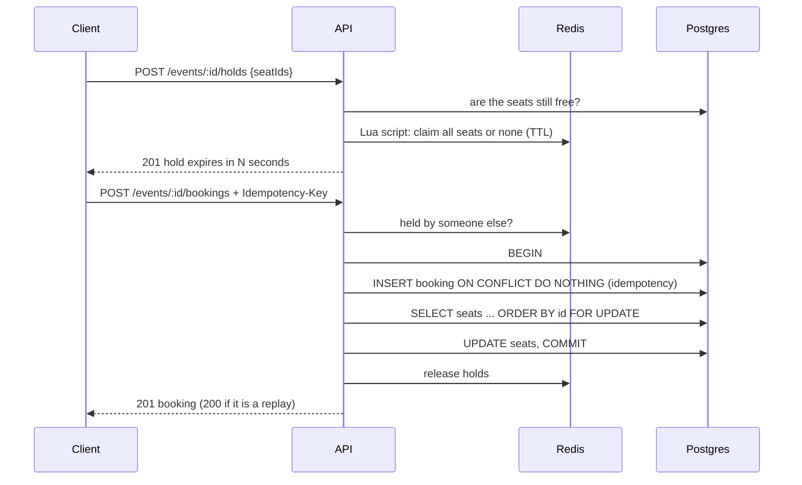

# Ticket Booking: Concurrent Seat Reservation System

A BookMyShow-style booking system built around one hard problem: **many users trying to book the same seat at the same instant, without ever double-booking.**

Postgres is the source of truth and enforces correctness with row locks. Redis adds temporary seat holds and rate limiting. Idempotency keys make retries safe. A React seat-map UI sits on top.

## Highlights
- **No double booking.** A Postgres transaction locks the requested seats with `SELECT ... FOR UPDATE` in a fixed order, so concurrent bookings can neither oversell nor deadlock.
- **Atomic seat holds.** A Redis Lua script claims several seats all-or-nothing, with a TTL so abandoned checkouts release themselves.
- **Idempotent bookings.** An `Idempotency-Key` header plus a unique constraint means retries and double-clicks replay the original booking instead of creating a duplicate.
- **Proven under concurrency.** Integration tests fire 50 simultaneous users at one seat (exactly one wins), and a k6 load test is followed by a database invariant check.

## Tech stack
| Layer | Technology |
|---|---|
| Backend | TypeScript, Node.js, Express 5 |
| Database | PostgreSQL (raw SQL with `pg`) |
| Cache / holds / rate limiting | Redis (`ioredis`, Lua scripting) |
| Validation and auth | Zod, JWT, bcryptjs |
| Frontend | React, Vite, TypeScript, Tailwind CSS |
| Testing | Jest, Supertest, k6 |
| CI | GitHub Actions |

## How a booking works



| Problem | Solution |
|---|---|
| Two users book the same seat at once | Seats are locked with `FOR UPDATE`. A waiting transaction re-checks `booking_id IS NULL` after the lock is released, no longer matches, and the request gets `409`. |
| Overlapping multi-seat bookings in opposite order | Locks are always taken in `ORDER BY id`, so a deadlock cycle cannot form. |
| Client retries or double-clicks | The booking row is inserted first with `ON CONFLICT DO NOTHING`. A concurrent twin blocks on the unique index, then replays the original booking. |
| User picks seats, then pays slowly | A Redis hold with a TTL reserves the seats softly. Postgres remains the source of truth at booking time. |
| Several seats must be held together | The Lua script checks and sets every key in one atomic step. |

## Features
- JWT authentication with roles (`user`, `admin`). The account registered with `ADMIN_EMAIL` becomes the admin.
- Admins create events, and the seat grid is generated in a single SQL statement.
- Live seat map with `AVAILABLE`, `HELD` and `BOOKED` states.
- Temporary seat holds with a countdown in the UI.
- Idempotent booking, cancellation (releases the seats) and a "my bookings" view.
- Redis-backed rate limiting per IP.
- Request validation with Zod and a central error handler.

## Getting started

**Prerequisites:** Node 20+, a PostgreSQL database and a Redis instance. Free hosted options work well: [Neon](https://neon.tech) for Postgres and [Upstash](https://upstash.com) for Redis. Local installs work too.

```bash
git clone <your-repo-url>
cd ticket-booking
cp .env.example .env        # PowerShell: Copy-Item .env.example .env
# fill in DATABASE_URL and REDIS_URL (rediss:// for Upstash)
npm install
npm run dev                 # API on http://localhost:3000, tables are created on start
```

Frontend, in a second terminal:

```bash
cd frontend
npm install
npm run dev                 # http://localhost:5173 (proxies /api to the backend)
```

Register with the email set in `ADMIN_EMAIL` to get the admin account, then create an event from the Admin page.

### Environment variables
| Variable | Required | Default | Notes |
|---|---|---|---|
| `DATABASE_URL` | yes | | Postgres connection string |
| `REDIS_URL` | yes | | Redis connection string |
| `JWT_SECRET` | recommended | dev value | Use a long random value outside local development |
| `ADMIN_EMAIL` | no | `admin@example.com` | The account registered with this email becomes admin |
| `PORT` | no | `3000` | |
| `HOLD_TTL_SECONDS` | no | `600` | Seat hold duration |
| `RATE_LIMIT_PER_MIN` | no | `300` | Requests per IP per minute |
| `BCRYPT_ROUNDS` | no | `10` | |

## Testing
```bash
npm test
```
The integration tests run against a real Postgres and Redis and cover:
- 50 users racing for the same seat: exactly one `201`, 49 `409`
- Overlapping bookings in opposite seat order (no deadlock, no oversell)
- Holds blocking other users, and 20 concurrent holds on one seat (one wins)
- Five parallel retries with the same `Idempotency-Key` (one booking created)
- Cancellation, ownership checks and admin-only event creation

To confirm the race test is meaningful, remove `FOR UPDATE` from the booking query: the concurrency tests fail.

## Load testing
```bash
npm run build
RATE_LIMIT_PER_MIN=1000000 npm start      # PowerShell: $env:RATE_LIMIT_PER_MIN=1000000; npm start
k6 run loadtest/k6.js
```
Then check that no seat was double-booked. Each booking in the test holds one seat, so the two numbers must match:

```sql
SELECT
  (SELECT count(*) FROM bookings WHERE event_id = (SELECT max(id) FROM events)) AS bookings,
  (SELECT count(*) FROM seats WHERE event_id = (SELECT max(id) FROM events) AND booking_id IS NOT NULL) AS booked_seats;
```

**Sample run:** 20 virtual users, 1,032 booking attempts against 2,600 shared seats: 0 failed requests, and the database check returned 849 bookings and 849 booked seats. That run used a hosted Redis in another region, so latency figures are dominated by network distance and are not a measure of the code. Run it against local or same-region databases for meaningful latency.

## API
| Method | Path | Notes |
|---|---|---|
| POST | `/auth/register`, `/auth/login` | `{email, password}` returns `{token}` |
| POST | `/events` | admin only: `{name, venue, startsAt, rows, seatsPerRow, price}` |
| GET | `/events`, `/events/:id/seats` | public |
| POST | `/events/:id/holds` | `{seatIds}` returns `201`, or `409` if unavailable |
| POST | `/events/:id/bookings` | `{seatIds}` plus `Idempotency-Key` header. `201` new, `200` replay, `409` unavailable |
| GET | `/bookings/mine` | current user's bookings |
| DELETE | `/bookings/:id` | owner only, `204` |
| GET | `/health` | liveness check |

## Project structure
```
src/          Express app, config, Postgres pool and schema, Redis holds
tests/        Jest + Supertest integration tests
loadtest/     k6 script
frontend/     React + Vite seat-map UI
.github/      CI workflow (build + tests)
```

## Known limitations
- **No payment step.** A booking confirms immediately. A production flow would add a `PENDING` state tied to the hold TTL, plus a payment webhook.
- **Holds are soft.** The database lock is what prevents double booking, not the hold.
- **Redis is a dependency of every request** (rate limiter and hold checks). If it is down, the API returns errors; making the limiter fail open would be a sensible hardening step. Postgres still guarantees no seat can be double-booked.
- **Booking correctness lives in the SQL.** A unique constraint on a `booking_seats` table would add a database-level guarantee behind it.
- **Fixed-window rate limiting** allows bursts at window edges; a sliding window or token bucket would fix that.
- **JWTs cannot be revoked** before they expire (1 day).
- **The seat-map endpoint is O(seats) and polled by the UI.** Large venues need pagination, caching, or push updates.
- **Schema is created at startup** with `CREATE TABLE IF NOT EXISTS`; a migration tool would be needed for evolving schemas.